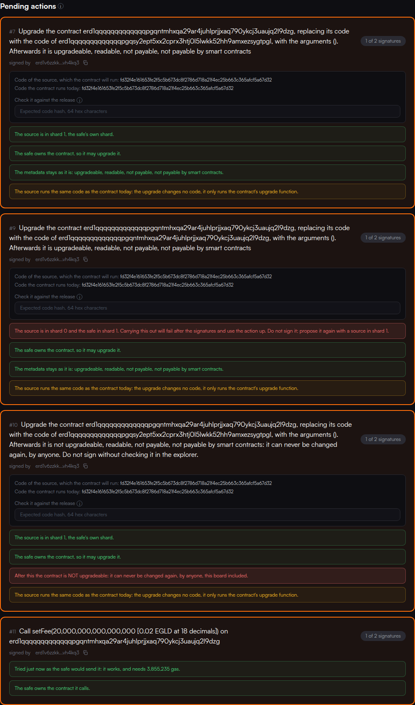

# Upgrading a contract the safe owns, and calling it

What mvxsafe does for a contract its safe owns, the rules it enforces, the gas it gives every
transaction and the devnet rehearsal that proves it. Written 13 October 2026, from the handoff
`mvxvest/docs/handoff/mvxsafe-upgrade-and-calls.md`.

## What a board member can do

Three new tabs under **Propose an action** on a safe's page:

- **Upgrade a contract.** The contract and a source contract that already holds the new code.
  The form reads both from the chain and shows what the signers will be shown:
  - the shard check;
  - both code hashes in hex;
  - who owns the contract;
  - the code metadata in words, starting from the contract's flags today.

  The proposal is only possible once a pasted **expected code hash** (the release's) matches the
  source.
- **Deploy a source**, inside the upgrade tab. Pick the release's `.wasm`. Its code hash
  (blake2b-256) is computed in the browser and has to match the expected hash; the wallet has to
  be in the safe's shard. The source is deployed not upgradeable, readable, not payable, without
  arguments. Its code hash is read back from the chain afterwards, then **Propose the upgrade
  with this source** fills it in.
- **Call a contract.** A function name and typed arguments: EGLD amount, whole number, address,
  text, hex bytes, true or false. A contract's `.abi.json` can be loaded to pick the function
  and give every argument its type; enums become their variants. The form shows the sentence the
  signers will read, the bytes that will be sent, and the call **tried as the safe would send
  it**. A call the contract refuses is not proposed.

On the **pending action**, every signer sees, without leaving the page:

- the sentence, with the metadata in words for an upgrade;
- the checks, green, amber or red;
- for an upgrade, both code hashes and a field to paste the release's hash, which turns green or
  red;
- once the quorum is reached, the gas carrying it out will be given. The performer can change it.



*From the devnet rehearsal: a valid upgrade, an upgrade whose source is in the wrong shard (red),
one that drops "upgradeable" (red), and setFee 0.02 EGLD tried as the safe.*

## What is refused before anyone signs

| What | Where | Why |
|---|---|---|
| A source in another shard than the safe | form and builder; red on the card | `performAction` reads the source's code in the safe's shard. Elsewhere it fails after every signature and uses the action up. |
| New metadata without "upgradeable" | form and builder; red on the card | The contract could never be changed again, by anyone. |
| A source whose code hash is not the release's | form; a red/green field on the card | The board would sign for code nobody checked. |
| A source that is still upgradeable, owned by anyone but the safe | form; red on the card | Its owner could swap the code between the signatures and the perform. |
| A contract the safe does not own, or that is not upgradeable today | form; red on the card | The network refuses the upgrade. |
| The safe itself as the contract to upgrade | form and builder | Out of scope for now; lift it deliberately if ever needed. |
| A call that fails when tried as the safe | call form; red on the card | It would use the action up. On the card it stays a warning, since the contract's state can change before the perform. |

A metadata flag that changes (payable on, for example) is red but allowed.

The two data strings of the handoff are rebuilt byte for byte in
`src/multisig/tests/upgradeAndCalls.test.ts`, one of them from mvxvest's own devnet transaction
`d753689b…`:

```
proposeAsyncCall@00000000000000000500f882d8136db7846cdb650b16134bb5424da58ddfe614@@736574466565@2386f26fc10000
proposeSCUpgradeFromSource@<contract hex>@@<source hex>@0500
```

## Gas

The rule: never more than about 1.5 times what is needed. Every limit is set in one place,
`src/multisig/gas.js`, last before signing, after the guardian is applied. The devnet scripts
import the same file.

- **Propose, sign, unsign, discard, and performs that stay inside the safe** (membership,
  quorum): the network's simulation plus a fifth. About 5M to 6.6M on devnet, where the flat
  `DEFAULT_GAS` used to send 60M. A simulation the network refuses stops the send with its reason,
  so nothing is paid for a transaction that would fail: "action does not exist", "quorum has not
  been reached".
- **Performs that send anything out of the safe's shard** cannot be simulated. An async call
  answers "no async context found"; even a plain EGLD transfer answers "nil vm output". They get a
  budget:

  ```
  7.5M (the safe's own part)  +  1.2 × the call's need  +  7M (the callback's lock, calls only)
  ```

  | Action | Need | Budget | Measured floor |
  |---|---|---|---|
  | EGLD to a wallet | 50,000 | **7.6M** | ~5.6M |
  | A token to a wallet | 331,000 (fixed built-in cost) | **14.9M** | ~13.3M |
  | `setFee`, `pauseCreation`… | tried as the safe: ~3.9M | **19.2M** | ~16.4M |
  | Upgrade to mvxvest's 26,540 bytes | 300 × bytes + 1M = 9.0M | **25.3M** | ~20.5M |
  | A call that could not be tried | 10M by default, said as such | 26.5M | — |

- **Deploying a source**: simulated plus a fifth, 105.5M for mvxvest (it carries its 26.5 KB as
  data).
- **Creating a safe**: the deploy is simulated plus a fifth: 96.1M on devnet, where it used to be
  a flat 250M (`d6612439cca2798f2e64f6f4476c36781c8670c537e5a3f801295207f72c4ac7`). The handover
  to itself is signed together with the deploy, so it cannot be simulated. It gets the fixed cost
  of `ChangeOwnerAddress` plus a fifth, 6,209,400 where it used to be 10M. It used 5,174,500
  (`4300b27c6d4f7e4fb895739008f556583dec6a3c1fb59b016604b087285b26ce`).
- **A guarded wallet**: the guardian is applied before the simulation, since the network will not
  simulate a guarded account's transaction without it, and 50,000 is added to every limit,
  budgets included.

### Where the handoff's figures were corrected, and why

Measured on devnet with the rehearsal below:

1. **An upgrade needs about 8.3M where it runs, not 88M.** The upgrade's async call carries the
   whole code (53,238 characters) but its size is not charged as data. With 112.5M forwarded, the
   contract used 8,264,045 and sent the rest back (`18ac094d…`). With 16.7M forwarded it used the
   same (`f2fc033b…`). Upgrades to a different build and back with 23.3M changed the code hash
   each time (`b91b6190…`, `778cc307…`). The handoff's 118.5M works, at about five times the
   need.
2. **The callback's lock is 6,458,200, not 4M.** Every callback that came back from a wallet or a
   failed call carried exactly that. With the handoff's 5M term, a token transfer (need 0.33M)
   ran out in the safe at 12.9M (`a0de137e…`). It failed whole, so the action stayed and nothing
   but the fee was lost. setFee only worked with 5M because the fifth on its 4M need covered the
   gap. The term is 7M now.
3. **A plain EGLD transfer cannot be simulated either** ("nil vm output"). With 12.6M it used
   about 5.6M in the safe and forwarded the rest with the EGLD to the wallet, where it was paid
   for and did nothing (`f0fcdb3b…`).
4. **A token transfer to another shard cannot be measured by a trial**: the network answers
   exactly 600,000,000 with no error. That answer is treated as "not measured", never as a need.
   A plain token transfer has a fixed cost anyway: 50,000 + 1,500 a byte of data + 200,000.

### Mainnet is not devnet

Mainnet runs an older protocol than devnet and spends gas differently in places. On mainnet a
token transfer to a wallet left the test safe with 0 gas and no callback (`3d07d1d7…`), where
devnet forwards everything and locks 6.46M. Every figure above is a devnet measurement.

So, decided on 14 October 2026: **on mainnet an upgrade is carried out with at least
118,500,000**, the figure that worked on devnet before the need was measured, until an upgrade
has been measured on mainnet. It costs about 0.001 EGLD more than the measured budget. Running out
would use the action up and need a new vote. The card shows the figure as raised and says why
(`MAINNET_UPGRADE_FLOOR` in `gas.js`). Calls keep their measured budgets. The first mainnet vote
of a call (setFee 0 is planned) shows in its callback SCR the lock mainnet uses; once an upgrade
has been measured there too, the floor can go.

## The devnet rehearsal

Run with throwaway keys from `~/.mvxsafe-devnet`, through the same builders and gas code as the
app: `node scripts/devnet/upgrade.mjs` (see its header for the steps). Everything it creates is
in `scripts/devnet/upgrade-state.json`, with every transaction hash.

| | Address | Shard |
|---|---|---|
| Safe, 2 of 3, owns itself | `erd1qqqqqqqqqqqqqpgqa36jq897x6drcq8arsumtw7tns8f98t3xezs2vdjvf` | 1 |
| mvxvest copy, 0500, owned by the safe | `erd1qqqqqqqqqqqqqpgqntmhxqa29ar4juhlprjjxaq790ykcj3uaujq2l9dzg` | 0 |
| Source, the release build `fd32f4e1…` | `erd1qqqqqqqqqqqqqpgqsy2ept5xx2cprx3htj0l5lwkk52hh9amxezsygtpgl` | 1 |
| Second source, mvxvest's local build `0a72bb09…` | `erd1qqqqqqqqqqqqqpgqhl2cqzx59s7t9j5n9svwvpgcd6e0tvwgxezsyw6deg` | 1 |
| Board | alice (shard 1), bob (shard 2), dave (shard 1, guarded) | |

As on mainnet, the safe and the contract are in different shards, so every perform is
cross-shard.

**Setting up**

| Step | Gas | Transaction |
|---|---|---|
| Deploy the safe | 250,000,000 (creation, unchanged) | `cb7edda940a7692522929a9e44d26116cc6e0e351745242195604f536161ca66` |
| Hand it to itself | 10,000,000 | `f6e718bd5fcd161a5dc21405b9b2ec7095f65cee81c0785be7c2541962898ee9` |
| Deploy the mvxvest copy from shard 0 | 105,538,856 | `a7187255780c61ef0cd7e4afaaa5a71adaa77fdde73c68b16be36ab3553ec549` |
| Hand it to the safe | 6,209,402 | `f44879a1f5ed878e889f40a70275cce0461e2f4cde1c1ba2a1614dec6bdefe7b` |

**setFee 0.01 EGLD, then getFee = 10000000000000000**

| Step | Gas | Transaction |
|---|---|---|
| Propose | 6,046,538 | `ad1a112c45c9cb7a51994220bdcfa51ec84a109eb17c8834586d814887d4cd82` |
| Sign | 5,130,996 | `67dcbebb222ff274090d0b802dcd0e6c42ec161473da6c3b8189c0a2a6f04305` |
| Carry out (need 3,855,585 tried as the safe) | 19,200,000 | `d9e11c2143220259b70486658ab11886a01ab3a35b621388bcdf274ace4f7765` |

The first run, under the handoff's 5M callback term: `5c5e6e9e…`, `aec656f6…`, `a65c9ed6…`
(17,300,000).

**Deploying the source and upgrading**

| Step | Gas | Transaction |
|---|---|---|
| Deploy the source in shard 1; the chain reports `fd32f4e1…`, the file's hash | 105,538,856 | `861359d3d151bf9e4c1eda38c1dbf44bc77f682fe4e69983a5153b0bcd1d7c96` |
| Propose the upgrade | 6,289,008 | `ee262bbda77c6afcfffbdadea399e164c7143f627998ce3fa130de054bbe4c5b` |
| Sign | 5,174,134 | `bffb2dfe7578879f675b6a674da2ac1a06f1d1eb39eab90175526df1f8cbed58` |
| Carry out | 25,300,000 | `4aa294fd2ab589d84145b94be02ccc9aeafad39fce0d2cb30394beb7e48f4d21` |

Afterwards the code hash was unchanged (same wasm), the metadata still `0500`, the safe still the
owner, and `getFee` still answered 0.01 EGLD. The first upgrade, with the handoff's budget:
`cf9f95a4…`, `93355db9…`, `18ac094d…` (118,300,000).

**The upgrade really replaces the code**, at the smaller budget: to a different build and back.

| Step | Gas | Transaction |
|---|---|---|
| Deploy the second build as a source | 105,724,976 | `57172988975c6bc1f037148369320f5a8ab99c6306a47ae7c5f4fde200d716a3` |
| Carry out the upgrade to it; the code hash became `0a72bb09…` | 23,300,000 | `b91b6190b76a665ee1d8bdd70b4bc1f3472e1f25bcb882bfad863c5e9744a4cb` |
| Carry out the upgrade back; the code hash became `fd32f4e1…` again | 23,300,000 | `778cc307e28fb37afef20b3075c663cba1b79deef6252c91348f6fdf358988fd` |
| The 22.5M experiment, same code | 22,500,000 | `f2fc033b111824abbe551517f55afccbf6c5fc55cdc14350d0a2e21bf1f61edb` |

The fee was kept through both upgrades.

**To mvxvest version 2**, staged by the mvxvest side (14 Oct 2026). It is the reproducible build
of branch `upgrade-v2` at `505f424`, code hash
`a7acbf22b8fdd8f1e624dfd1354aacae4ccb20c0ef5974e1946704359bab718a`, 27,332 bytes. The source is
`erd1qqqqqqqqqqqqqpgq3p9mg88g2dth097vrwcasr4n7eutztf0erksnkk738`: shard 1, not upgradeable. Its
code, read back from the chain, hashes to the release hash. Run with
`node scripts/devnet/upgrade.mjs to <source> <hash>` and `… call setTokenFee number:100`.

| Step | Gas | Transaction |
|---|---|---|
| Propose the upgrade | 6,289,008 | `fb2bd7595a4ab1e7441ada3456a03d031ca3ed8914864d0d9241eb35dedc56ef` |
| Sign | 5,050,364 | `98bfca14a4e435ffd59ca0bea8ce46d2502d45c949f43c8f6592f845c057896d` |
| Carry out: the code is now `a7acbf22…`, metadata 0500, the fee kept; the upgrade used 8.50M (model: 9.2M) | 25,600,000 | `f8e1e1f5b748b49d64f3ed6564c4f486b55d4749cec9039dc2ca48aa7fd40032` |
| Propose `setTokenFee@64` (100 basis points) | 6,030,818 | `dc34c9154d23af82927ec580eda23e14f0e41e7c64791f83a4cbdc9343f5f879` |
| Sign | 5,173,294 | `386545d53b6ba6874fa2a43cce2e0d380977303c81344bf7aae22ed4677194f4` |
| Carry out (need 3,938,360 tried as the safe); then `getTokenFee` = 100, `getMaxTokenFee` = 200 | 19,300,000 | `851cb78e7cff88d799138bd9c78122e4edb5d412006086d9d36c10ffa5cb63d9` |

A one-byte argument such as `64` used to read as the letter "d" on the card. It now reads
`setTokenFee(100 [or the text "d"])`.

**The failure paths**

- Refused by the builder before anything was sent: a source in shard 0 (mvxvest itself), and
  metadata `0400`.
- Proposed by hand anyway, as another tool could, and shown red on the safe page before any
  signature (the picture above):
  - wrong shard: `22159bfb1645599bd80b9a06d4a469e8d6e857bb12c261691d1f7d6dd65fc8b3`;
  - without "upgradeable": `27a22c7fbb2dcbafd5d2e0096eb5594f7c90dccbdd40d71549178e86b96287d6`.

  Both were then unsigned and discarded.
- A mismatched expected hash turns red and keeps Propose disabled; proven in
  `src/multisig/tests/upgradeForms.test.tsx`.

**The existing actions under the new gas rules** (`node scripts/devnet/cycle.mjs`, on the older
test safe `erd1qqqqqqqqqqqqqpgqlwavx7tm30262mt7jhwu8qmwaj0z2yzpxezshvnjyy`):

| Action | Gas | Transaction |
|---|---|---|
| Carry out an EGLD transfer | 7,600,000 | `800f7fe785784cb7e731a287c3e9ba6c86ab8795033412a7acf8d0b715a80bd1` |
| Carry out a token transfer | 14,900,000 | `3588df355090f86cd553b88140cacb10bf621d6e3d754c0584d4df06ba4a8670` |
| Carry out quorum 3, simulated | 6,764,535 | `83be90046f4809d27fb61bb770c15c15361f23bf051ca034946f2ed755c03033` |
| Carry out quorum 2, simulated | 7,288,569 | `8883653a8564c8b709528fe4ddc4eef687f439b77104474bf5a9f7ccec7559d3` |
| Unsign, simulated | 5,063,349 | `e3c6c01517d8c4f019bc7c94fa6c714aecd349919d3f29f0eca0a1b2d4bb1b59` |
| Discard, simulated | 4,771,595 | `2af544e2dbf501d27b34f4f71d92a1aa10251f25e4cbafb83f56d8fdea59f929` |

### From a guarded wallet

Two of the three mainnet signers have a guardian. `src/multisig/tests/guardedActions.test.ts`
drives every function that sends something from a guarded wallet:

- propose (all eight kinds), sign, unsign, discard;
- carry out, simulated or with a budget;
- deploy a source, create a safe, hand one over.

In each, the guardian is on the transaction before the network simulates it, and 50,000 is added
to its limit, budgets included.

On devnet, 14 Oct 2026, from dave (`erd1wdqwnz0kdswj6njp0yzllkd5q4km9ygvtkme4zlg5kn026mdzc0s77fspw`,
shard 1):
- dave's guardian `erd13n5qd94ukuu2s2e3dppavdp0v7q89hj0nk9x2tulhlqyu6hcxy9s3xw87f` was set by
  `c0830073f9bec9f1ae6a630741c0723d1717c86c9a86c9dceadc1bad217647c7`, became active at epoch
  6743, and was switched on by `3b7c20953b3521e98a402f0648bb4f5e3a29a1030d831b81c893e3de562d9a6f`;
- every transaction below carries the guardian and its co-signature, and its limit carries the
  guardian's 50,000 on top;
- the copy runs mvxvest v2, so dave's source is the same v2 build, `a7acbf22…`.

| Step, by the guarded wallet | Gas | Transaction |
|---|---|---|
| Deploy a source; its code is the release's | 108,785,176 | `dc4362671720c6b61ecb9b04a64d25b2b01f5df9b644a94b01bc5752a9a7d2e9` |
| Propose pauseCreation | 6,089,554 | `747b8d70b0b00c6be2558d6dfbc0c3dd0ec028ebe0342ee45391a8acdfa88322` |
| Carry it out (19.3M budget + 50,000); `isCreationPaused` = true | 19,350,000 | `fb96f39364819bb18f9b91fc4c2af13309f6c8786fd746b71e0dd95e099b8408` |
| Sign unpauseCreation | 5,074,748 | `3a970ed07f508fffb120173f1f52ecb53e2709847a3708f78403765261e0ac6f` |
| Carry it out; `isCreationPaused` = false | 19,350,000 | `59129c9112ccc6ff86b05214fffe45d09ca646b1ca1bab094f86001dda5e8b9c` |
| Propose the upgrade from dave's source | 6,399,008 | `aded8332008b6d7f87700f6b47b728a5f137d28b3bbdda259790f64f79cdceb3` |
| Carry it out (25.6M budget + 50,000); code and metadata 0500 as expected | 25,650,000 | `9802ad89a129b7087c1b2fdb2b175b045ddae0d4caf778bc5e506b4414f6f17d` |
| Propose setFee, to take it back | 6,156,538 | `1c583620873bb6490d26f6dac1367b9c549c01613f0a8fea3b94228460fa4fd8` |
| Unsign it | 5,051,318 | `c446bf778dfe3685a9a147d928fbcc866a5212f30d69a8c4ea6991ffefe01c1f` |
| Discard it | 4,717,118 | `36b775a77017aaa12b60a72f48b81f01362bb3fe05790b308bc37883da6bb31f` |

Every simulation was accepted with the guardian on the transaction. A guarded proposal costs about
110,000 more than the same one unguarded (6,399,008 against 6,289,008). The simulation already
counts the guarded transaction's 50,000, and the 50,000 the handoff asked to add comes on top.
That is redundant but harmless.

Run with `MVXVEST_WASM=<mvxvest v2 .wasm> node scripts/devnet/upgrade.mjs guarded`.
