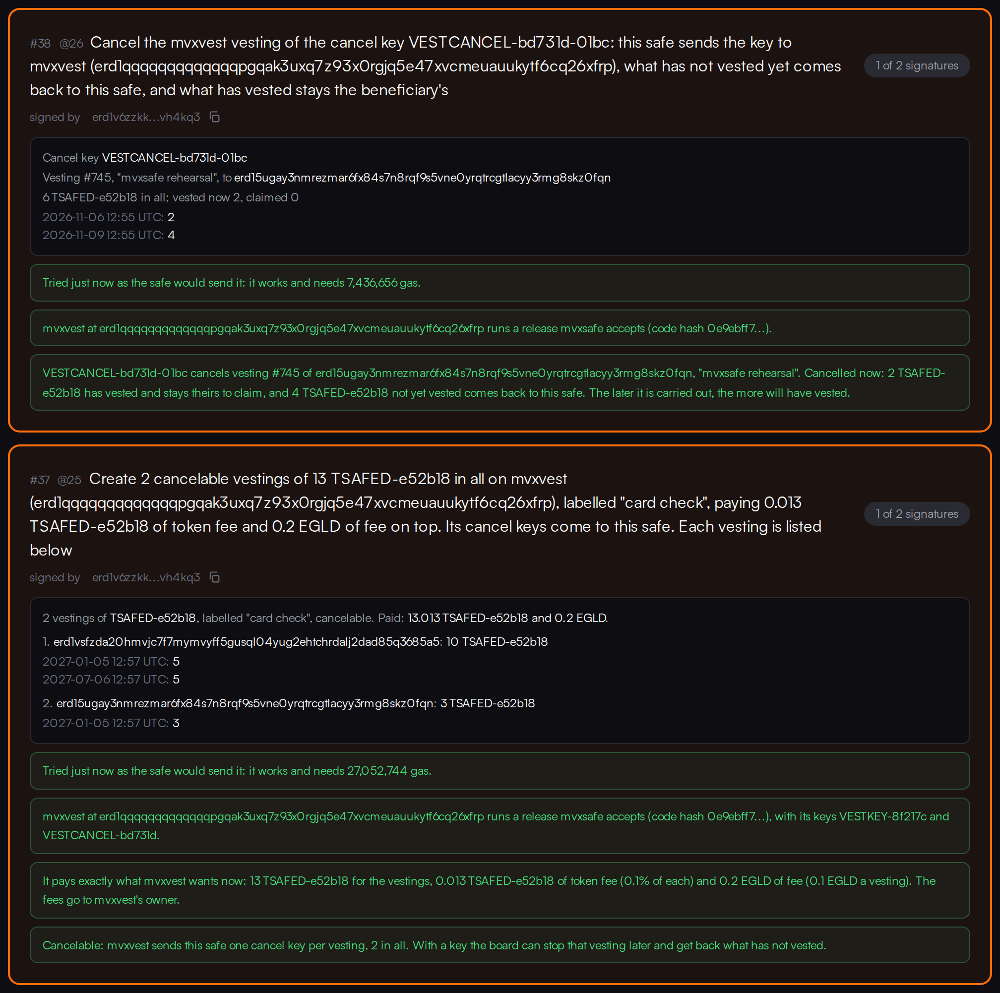

# Creating and cancelling mvxvest vestings from a safe

What mvxsafe does when a safe creates vestings on mvxvest itself, the rules it enforces, the gas it
gives every carry-out and the devnet runs that prove it. Written 6 November 2026.

In mvxvest the cancel key (VESTCANCEL) goes to whoever calls `createBatch` or `create`. A cancel pays
what has not vested back to whoever sends that key. So when the safe is the caller, the keys stay
with the safe. So does every refund. No token passes through a signer's own wallet.

## What a board member can do

Two new tabs under **Propose an action**, shown only where the network pins an mvxvest (mainnet
and devnet):

- **Create vestings.**
  - **What is typed:** the token, cancelable or not, a label (64 bytes at most) and one line per
    tranche: `beneficiary, date (UTC), amount`. Each beneficiary gets one vesting, with all of
    their lines as its tranches.
  - **Pasting:** lines paste straight from a spreadsheet, with commas, semicolons or tabs between
    the values.
  - **A schedule for one person** can write their lines: equal tranches every N months, with the
    rounding remainder in the last one.
  - **What the signers will see** is shown before anything is proposed: every vesting with its
    dates and amounts, what the safe pays, mvxvest's fees and the gas the carry-out will be given.
  - **The fees are read again at Propose.** If they changed since the form showed them, nothing
    reaches the wallet.
- **Cancel a vesting.** The form lists the cancel keys the safe holds. Next to each key it shows the
  vesting it stops and what stopping it now would do: what has vested stays the beneficiary's
  and the rest comes back to the safe.

The safe's **holdings** list its mvxvest cancel keys, each with its vesting.

## The rules

What the form refuses, the builder (`src/multisig/vesting.js`) refuses too. They check against
what was read on chain at that moment:

- **The contract:**
  - only the network's pinned mvxvest, which must run a release mvxsafe accepts (version 4, code
    hash `0e9ebff7c674c9fa4fb7c950a6edfb239a63ba688e88663b2f606ab45db04246`, hashed from the code
    itself);
  - its key collections must be the pinned ones;
  - creation must not be paused;
  - the safe must be payable by smart contracts. Otherwise the keys and refunds could not reach it.
    Every safe made with mvxsafe is.
- **The vestings:**
  - one fungible token, never EGLD;
  - at most 32 vestings when cancelable, 49 when not;
  - at most 120 tranches each, every one more than zero;
  - dates in the future and strictly increasing, the last within 30 years;
  - no beneficiary that is the safe itself, mvxvest or the zero address.
- **The payment:**
  - mvxvest wants it exactly: the sum of the vestings, plus each vesting's token fee in the token,
    plus each vesting's EGLD fee in EGLD;
  - the safe must hold both.
- **The size:** at most 8,000 bytes stored in the safe, counting each argument's length prefix. A
  larger action could not be read back. It would hide every other pending action (audit SC-01).
  With eight half-yearly tranches of a real amount, that is about 30 vestings a proposal.
- **The gas:** the carry-out's gas must fit in one transaction.

**Fees.** mvxvest's owner can charge a share of each vesting in its own token (`setTokenFee`, at most
2%) and an EGLD fee per vesting (`setFee`, at most 1 EGLD). Both go to mvxvest's owner. The safe pays
whatever they read:

- **Both read zero:** the action is the safe's own token transfer, `ESDTTransfer`, with
  `createBatch` after it, sent to mvxvest.
- **The EGLD fee is above zero:** the safe pays the token and EGLD together. A contract sends two
  payments by running `MultiESDTNFTTransfer` on its own account, so this action is a call to the
  safe itself.

To create without fees, mvxvest's owner sets both to zero first, with **Call a contract**
(`setFee 0`, `setTokenFee 0`). Then propose. While they read zero, nobody pays them.

**A cancel** is a call to the safe itself: `ESDTNFTTransfer` of the key, with `cancel` after it on
the pinned mvxvest. That is how a contract sends an NFT.

**The call form** keeps refusing every token transfer and every other built-in function (audits
UPG-01, SEE-01 and TXN-04). Only these two narrow actions build them. They build them only for
the pinned contract.

## On the card

A vesting action is **green only when** it goes to the pinned mvxvest running an accepted release
**and** pays exactly what mvxvest wants **now**. The card shows:

- one sentence: how many vestings of what in all, the label, the fees on top and whether the
  cancel keys come to the safe;
- every vesting with each date and amount, and what the action pays;
- the checks:
  - the code hash;
  - the payment against mvxvest's fees now. A fee changed since the proposal is **red**: carried
    out, it fails, the tokens come back and the action is used up;
  - the safe's balances and whether it can receive the keys;
  - a tranche date that has passed, in **amber**: it vests at once;
  - a batch that cannot be cancelled, in **amber**;
- for a cancel: the key, the vesting it stops, what has vested and stays the beneficiary's, and
  what comes back to the safe now;
- **red** for the same call to any other contract.

## Gas

The network cannot simulate the call as a safe in another shard. So the carry-out gets what
devnet measured, plus a fifth, plus the safe's 7.5M and the callback's 7M. The card takes the larger
of that and a trial as the safe, when the network gives one.

Measured by simulation on 6 November (`scripts/devnet/vest-gas.mjs`):

- **On the pinned devnet mvxvest:** its keys' display is set and its fees are on. There a
  cancelable vesting costs 9.9M, one that is not 6.8M, a tranche 0.4M and the rest about 6.8M.
- **A fresh copy of the same code** costs less.
- **Real carry-outs:**

| Carry-out | Used by mvxvest | The formula's need |
| --- | --- | --- |
| #33, 2 vestings of 2 tranches, fees paid (pinned contract) | 25,076,346 | 36,000,000 |
| #34, 27 vestings of 10 tranches, no fees (copy) | 279,123,102 | 466,000,000 |

**The formula:**

| Part | Gas |
| --- | --- |
| Base | 7M |
| Fees paid | +3M |
| Each vesting | 12M if cancelable, 8.5M if not |
| Each tranche | +0.5M |

Every part is rounded up by about a third. Too much costs about a thousandth of an EGLD. Too little
uses the action up.

**A cancel** of one key needed 6.3M when simulated as the safe in its own shard. It is given 10M.

## The devnet runs

**Keys.** All are throwaway devnet keys in `~/.mvxsafe-devnet`, never in git.

**The safe.** `erd1qqqqqqqqqqqqqpgqa36jq897x6drcq8arsumtw7tns8f98t3xezs2vdjvf`: 2-of-3 (alice, bob,
dave), shard 1. alice proposes and carries out, bob signs.

**The contracts:**

| Contract | Address | Shard | Notes |
| --- | --- | --- | --- |
| The pinned devnet mvxvest | `erd1qqqqqqqqqqqqqpgqak3uxq7z93x0rgjq5e47xvcmeuauukytf6cq26xfrp` | 0 | fees 0.1 EGLD + 10 bps |
| Copy 1 | `erd1qqqqqqqqqqqqqpgq47urq5rmd2x54tp638hejcm5uyn9t6ymaujqqxf98a` | 0 | carol's |
| Copy 2 | `erd1qqqqqqqqqqqqqpgqunhaauldrd4sr73ks7a93tmmkyuxaj0mmg8sshugvn` | 1 | frank's: the safe's own shard |

Both copies run version 4. Their fees are set as each test needs.

### The first question: can a safe hold the keys? (`scripts/devnet/vest-probe.mjs`)

**Yes**, with mvxvest in another shard and in the safe's own shard alike.

| Step | Action | Hash |
| --- | --- | --- |
| Copy 1: createBatch, 2 cancelable vestings (16 TSAFED); both cancel keys arrive in the safe | #28 | `f810104c570118f55368bab9d07e1491174b64e014654a9e9472c2a8e3e9d296` |
| erin claims her first tranche (4) | | `63e4f55e7ecb6c0ecb482ddf9ee85856f70048a488d69ec163a192c17c242b96` |
| The safe cancels erin's vesting; its 6 unvested come back | #29 | `6d4dee2e0c529cf7731a72f86be667cb8d80ce88fdebe6238ca12242ef5722a2` |
| createBatch paying both fees (2.002 TSAFED and 0.001 EGLD in one transfer); the key arrives | #30 | `26a7a8d9b9cb1fd0fa932a679ef9790ce28202bd962673fb15b8e61df6243ea6` |
| Copy 2, same shard: createBatch; both keys arrive | #31 | `56d485a3c51a7bc77342ad898cfc91576833f14ad93ae863e4234115a53422d7` |
| erin claims | | `155cfb07e65b9092605cbfe9d7f2616ecf5e5b4aed85ea772abe077d244463ab` |
| The safe cancels; its 6 unvested come back | #32 | `5d02330efc3f18e37d396b8ed5fe617b7177caca4915f94ec16281ce665e1284` |

The proposals of #28, #29 and #30 are rebuilt byte for byte by the shipped builders in
`src/multisig/tests/vesting.test.ts`.

### The rehearsal (`scripts/devnet/vest.mjs`, shipped builders)

| Step | Action | Hash |
| --- | --- | --- |
| On the pinned contract: 2 cancelable tranche vestings, paying exactly 16.016 TSAFED and 0.2 EGLD; both cancel keys (`VESTCANCEL-bd731d-01bb`, `-01bc`) arrive in the safe | #33 | `b663aa15fc7f17f8060d0d08d6ede73b5b5041ff67b089da616fe090239b6b80` |
| erin claims her first tranche (4) | | `7caac371747d1ade7276c4b3271398f775a1ea6b2e7464d07a3ff7139e04a9bb` |
| The safe cancels erin's vesting #744; its 6 unvested come back and the key is burned | #36 | `285f76a2311b2cc1a0dfe73d6cb606a194b20d0dbcd755dda008a3325936ad2c` |
| Copy 1: the largest batch the form allows, 27 cancelable vestings of 10 tranches. The safe returns it alone (7,827 bytes) and in its pending list; carried out, all 27 keys arrive | #34 | `29cd47b453abe79838c0cdd8df9bb56bd7b5187b750e55f29f5b1402ba4556f0` |
| Copy 1: a batch signed at zero fees; the owner then sets a fee; the carry-out fails ("EGLD sent must equal the fee"), the 1 TSAFED comes back and the action is used up | #35 | `8b972d4222f1ce3611dd0261ee140826fd4d76911d025493f229d2ce1e231a56` |

Every other hash, propose and sign included, is in `scripts/devnet/vest-state.json` and
`vest-probe-state.json`.

**The cards.** `scripts/devnet/vest-cards.mjs` reads them in a local devnet build, with no wallet.
Two actions were left pending on the safe:

- **#37, a batch:** the sentence; the list (erin 10 = 5 + 5, frank 3); "pays exactly what mvxvest
  wants now: 13 TSAFED for the vestings, 0.013 TSAFED of token fee (0.1% of each) and 0.2 EGLD of
  fee"; the code hash; "one cancel key per vesting, 2 in all".
- **#38, a cancel of `VESTCANCEL-bd731d-01bc`:** "cancels vesting #745 of frank ... Cancelled now:
  2 TSAFED has vested and stays theirs to claim. 4 TSAFED not yet vested comes back to this
  safe".

## Not covered

- **A safe that is not payable by smart contracts** is refused, so what such a safe would do with
  the keys was not tried.
- **Vesting EGLD itself, or a linear or stepped schedule,** is not proposed. A card still reads
  them and lists them, in amber for a schedule that is not tranches.
